  <a href="https://www.linkedin.com/in/guruvishnu-kajagar-">LinkedIn</a> / 
  <a href="https://guruvishnuportfolio.vercel.app">3D Portfolio</a> / 
  <a href="mailto:guruvishnu1927@gmail.com">Email</a> / 
  <a href="https://github.com/guruvishnuk">GitHub</a>

---

## 01 — Numbers

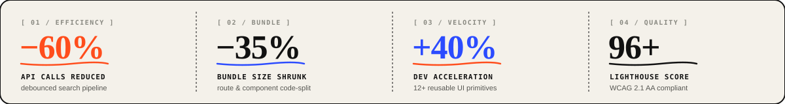

---

## 02 — Selected work

<table>
  <tr>
    <td width="50%" valign="top">
      <a href="https://github.com/guruvishnuk/codelab">
        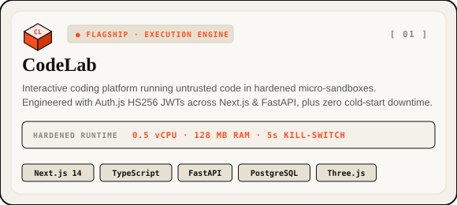
      </a>
    </td>
    <td width="50%" valign="top">
      <a href="https://guruvishnuportfolio.vercel.app">
        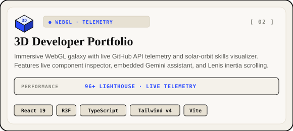
      </a>
    </td>
  </tr>
  <tr>
    <td width="50%" valign="top">
      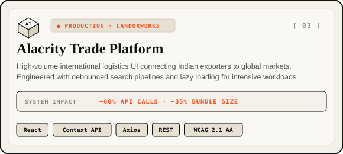
    </td>
    <td width="50%" valign="top">
      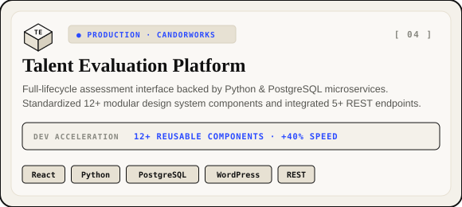
    </td>
  </tr>
  <tr>
    <td width="50%" valign="top">
      <a href="https://github.com/guruvishnuk/Secure-e-voting-system-using-iris-recognization">
        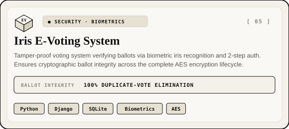
      </a>
    </td>
    <td width="50%" valign="top">
      <a href="https://fresh-bites-foodrecipe.vercel.app/">
        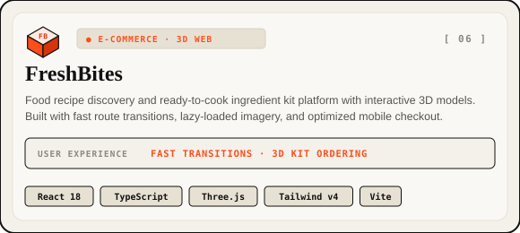
      </a>
    </td>
  </tr>
</table>

---

## 03 — Stack

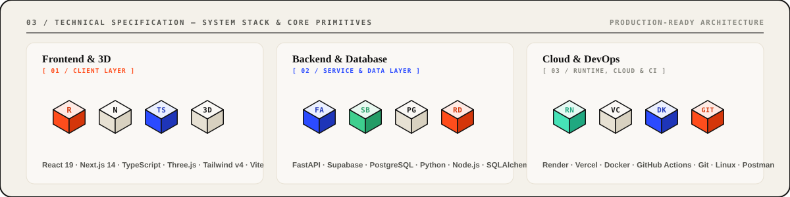

---

## 04 — Now building

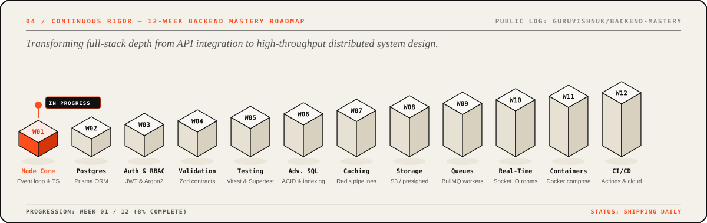

Track my weekly architecture deep-dives and production implementations in [`guruvishnuk/backend-mastery`](https://github.com/guruvishnuk/backend-mastery).
Shipping daily commits covering V8 internals, database indexing, caching strategies, and distributed systems.

---

## 05 — About

Frontend Developer at CandorWorks in Pune, where I shipped a real-time international logistics UI (Alacrity Trade Platform) and an enterprise assessment platform (Talent Evaluation Platform). Honored as Best Coder of the Week (Java) at J Spiders. Currently deepening distributed backend engineering across Node.js, PostgreSQL, Redis, and Docker.

---

## 06 — Contact

<a href="mailto:guruvishnu1927@gmail.com">
  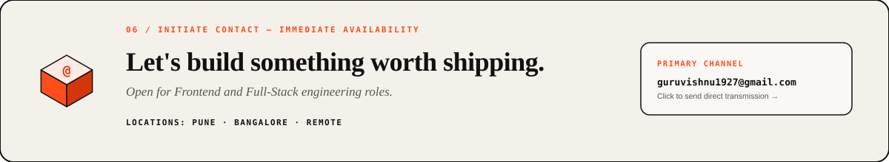
</a>

---

<picture>
  <source media="(prefers-color-scheme: dark)" srcset="https://raw.githubusercontent.com/guruvishnuk/guruvishnuk/output/github-contribution-grid-snake-dark.svg" />
  <source media="(prefers-color-scheme: light)" srcset="https://raw.githubusercontent.com/guruvishnuk/guruvishnuk/output/github-contribution-grid-snake.svg" />
  
</picture>
